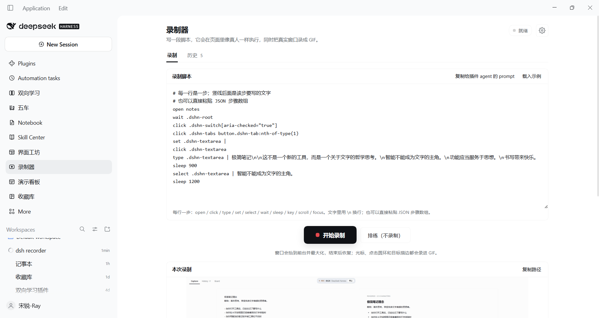
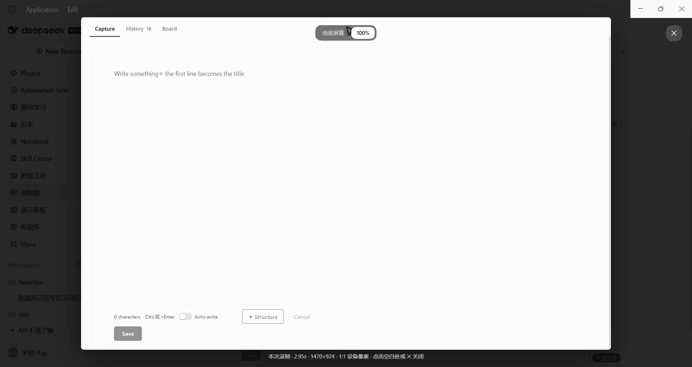
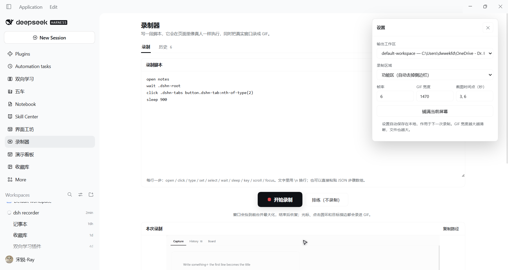
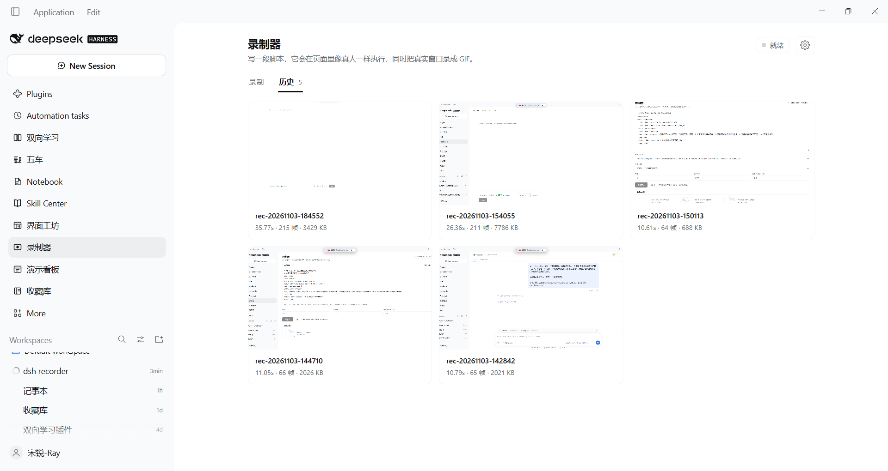
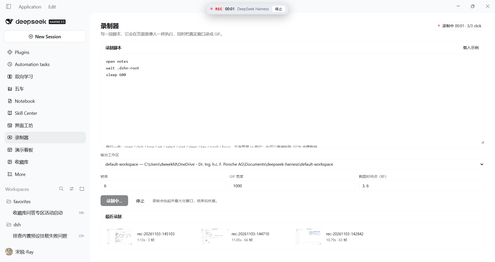
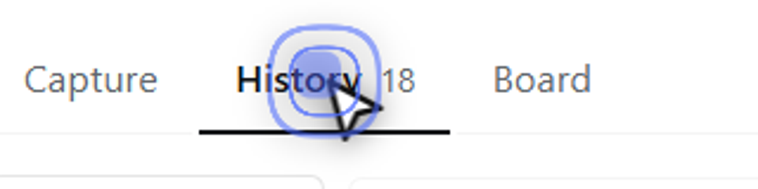
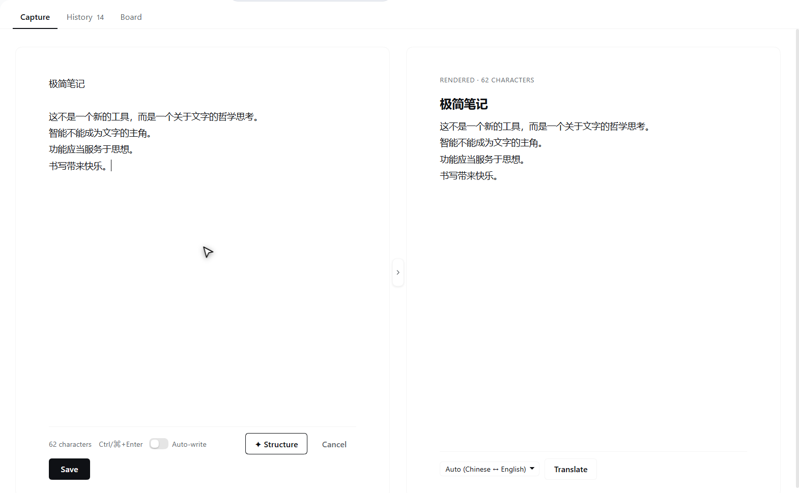

# dsh-recorder

Records a DSH plugin's **real** interface — the pixels of the running app, not a re-render — and turns
that into a GIF or stills. It also **drives** that interface like a person: typing with real input
events, clicking buttons, selecting a range of text, switching panels.

Two ways to use it:

- **The panel**: sidebar → 「录制器」, paste a script, press 「开始录制」. The page executes the script
  while the real window is recorded, then shows the GIF.
- **Agent tools**: `recorder_scan` → `recorder_demo` for a one-shot recording from a conversation.

**Status: v0.1, installed and verified on this machine.** A real notes walk produced a 10.8 s,
65-frame, 2.0 MB GIF plus three stills (`recordings/rec-20261103-142842/`). The plugin is installed as
`@tyouter/dsh-recorder` in the `desktop` profile; the row is `include:dsh-recorder`.

## The panel



Sidebar → 「录制器」 opens a page with two tabs.

**录制** — the whole workflow is one centred column:

| Part | What it does |
| --- | --- |
| 录制脚本 | The script, front and centre. JSON steps or one step per line (see below); kept in `localStorage` between visits. |
| 复制给插件 agent 的 prompt | One click copies a self-contained prompt (the full spec + what to output). Paste it into the agent that owns the plugin, describe the demo, and it returns a script you paste back. `载入示例` restores the notes walk that the verified GIF came from. |
| 开始录制 | The primary action, a large button under the editor. `排练（不录制）` runs the same steps without recording (real clicks, no video); `停止` ends early. A rehearsal brings the window forward first — a background window throttles the page's timers and would freeze the walk. |
| 本次录制 | The result of this run: a large GIF preview (click it for a full-size lightbox), its length/frames/size, the path, and the per-step log. The lightbox opens at **100%** — one GIF pixel per device pixel, so the text is exactly the physical size it had on screen; `适应屏幕` fits the whole frame instead (smaller text). |



**⚙ 设置** (top right) opens a popover with the parameters — they are no longer mixed into the main
page:

- 输出工作区 — which registered workspace's `recordings/` receives the output.
- 录制区域 — `功能区` (crop to the main panel), `整个窗口`, `自定义区域` + a CSS selector.
- 帧率 / GIF 宽度 / 截图时间点 — 6 fps. The GIF width defaults to the content's **physical** pixel
  width (≈1470 on a 125% display) so the preview is never upscaled; lower it to shrink files, and
  remember the encoder cannot add detail beyond the source. Stills are seconds.
- 铺满当前屏幕 — maximize on the monitor under the cursor.



**历史** — a grid of past recordings of the selected workspace (thumbnail, name, length, frames,
size). Click a card to open it with the GIF, meta, path and copy button. Click the preview (the
`⤢ 全尺寸` badge) to open the full-size lightbox; click the backdrop or ✕ to close.

The detail view also has **删除这段录制**: the first click arms the button, the second confirms and
removes the recording directory from disk. Only directories directly under a recordings root whose
name matches `rec-YYYYMMDD-HHMMSS` can be deleted (the route refuses anything else).





While a run is active the status pill counts steps (`录制中 00:01 · 3/3 click`) and the floating REC
pill below the title bar shows the clock and a stop button. A rehearsal gets the same pill in blue
(`排练 2/10`) with its own stop, so it can be ended even when the script has switched away from this
page. The panel is in the main area, so a script that opens another plugin's panel will hide it — the
pill stays visible, and coming back to the recorder panel shows the finished result.

The pill sits at `top: 46px` on purpose: the very top strip of the window is its drag region, and a
click there belongs to the window manager, not to the button. Pressing 停止 hides the pill immediately
while the GIF is assembled, so a long splice never looks like an ignored click.

### Window size

`铺满屏幕` (and, when `maximizeOnStart` is true in the patch, a moment after the plugin activates)
moves the app window to the monitor under the cursor and maximizes it, so a freshly launched Harness
fills the current screen instead of opening at its remembered size. Focusing the window for a rehearsal
never changes its size: a maximized window stays maximized, at the same rect. Window geometry is the
plugin's business; **UI scale is not** — the interface still follows the Windows display scale of that
monitor (120 DPI = 125% here). For a 1:1 UI, set that monitor to 100% or launch the app with Chromium's
`--force-device-scale-factor=1`; a page plugin cannot change the process's DPI mode.

Keep the Harness window visible while a walk runs: Chromium throttles a background window's timers,
which freezes every `sleep`/`wait` in the script (and delays a stop). The rehearsal brings the window
forward before it starts; the capture does the same by design.

### Cursor and click effects

The driver paints the pointer into the page, so the effects are part of the recording — no
post-processing, the frames are the page:

- a short blue trail follows a move, including a jump across the screen (two breadcrumbs are laid on
  the straight line when the distance is large);
- **two expanding blue rings plus a flash** mark the click;
- the clicked element gets a **temporary blue outline**, so the target is obvious even when the
  pointer is small.



All of it is disabled under `prefers-reduced-motion` (the outline and the pointer are still drawn).

### Recording area

`功能区` is the default and is what most demos want: the page measures the main panel's box and sends
the **insets in CSS pixels plus `devicePixelRatio`**; the Host maps them through the window's real
client area (Win32 `GetClientRect` + `ClientToScreen`) and crops every frame. The window is still
maximized for the shoot — the crop is what removes the sidebar and the app title bar, and
it stays correct on a mixed-DPI desktop because the mapping is measured, not assumed.

Because the crop is the **main panel**, the GIF's aspect ratio is the panel's, not the window's
(e.g. 1544×970 for a 1920×1020 window). The image is still scaled proportionally; if the framing has
to match the full window, pick `整个窗口`.

- `整个窗口` records the maximized window as-is (sidebar included).
- `自定义区域` takes a CSS selector and crops to that element's box; the element must exist when you
  press start.
- If another app takes the foreground mid-recording, those frames show that app; the result then
  carries a `⚠` warning rather than pretending the footage is clean.



The same walk in `功能区` mode: 10.6 s / 64 frames / 705 KB, against 2.0 MB for the full-window cut —
the sidebar and app title bar are simply not in the frame.

### Script syntax

One step per line; `|` introduces the text for that step. Lines starting with `#` are comments.

```
# 打开记事本，写一段笔记，选中一句
open notes
wait .dshn-root
click .dshn-switch[aria-checked="true"]
click .dshn-tabs button.dshn-tab:nth-of-type(1)
set .dshn-textarea |
click .dshn-textarea
type .dshn-textarea | 极简笔记\n\n这不是一个新的工具，而是一个关于文字的哲学思考。\n智能不能成为文字的主角。\n功能应当服务于思想。\n书写带来快乐。
sleep 900
select .dshn-textarea | 智能不能成为文字的主角。
sleep 1200
```

- `open <panel>` — switch to another plugin's main panel (`notes`, `wuche`, `conversation`, …).
- `click <selector> [| text]` — click a button/tab; `text` picks among matches.
- `type <selector> | text` — type character by character (60 ms each); `\n` inserts a newline.
- `set <selector> | text` — set the value in one go (good for clearing a draft).
- `select <selector> | text` — highlight that text.
- `wait <selector> [timeoutMs]` — wait for an element (default 8 s).
- `sleep <ms>`, `key <selector> <Tab|Enter|Escape>`, `scroll <selector>`, `focus <selector>`.

A JSON array of step objects works too — starting the box with `[` switches the parser. Step objects
use the same `op` names the agent tools use, and can set `ms` on `type`.

A step whose element is missing is reported as failed and the walk continues (unless the JSON sets
`strict: true`). Selectors come from the plugin's real DOM; the agent tool `recorder_scan` prints them.

The full, versioned grammar is in [docs/script-spec.md](docs/script-spec.md). Before spending a
recording, press **排练（不录制）**: it runs the same steps for real and lists `✓`/`✗` per step, so a
wrong selector shows up in a second instead of in a wasted GIF.

### Writing a script with another agent

The plugin's own agent knows its components and class names, but not the recorder's grammar. Hand it
the prompt:

1. Press **复制给插件 agent 的 prompt**.
2. Paste it into that plugin's agent conversation, replace the last paragraph with what you want to
   see (`打开记录页，点 Structure，输入一句话…`), and send.
3. The agent answers with one code block. Paste it into 录制脚本, press **排练（不录制）**, then **开始录制**.

The prompt carries the whole spec, so the other agent does not need this repository. If you also want
it to use *real* selectors, send it the output of `recorder_scan` (the agent tool) for the panel you
mean; the prompt tells it to prefer that list.

## Agent tools

| Tool | What it does |
| --- | --- |
| `recorder_windows` | Lists recordable windows (title, screen rect, size) and reports the capture backend. |
| `recorder_scan` | Reads the live DOM and returns the visible interactive elements with real CSS selectors. |
| `recorder_start` / `recorder_stop` | Manual start/stop; `start` returns a `probe` frame to check the target. |
| `recorder_drive` | Runs steps against the live page without recording, or while a recording runs. |
| `recorder_demo` | start → drive → settle → stop in one call. |

## How it works

- **Capturing** pixels happens in the Host half: screen capture of the real window through
  `tools/record-window.py` (Win32 + Pillow). It knows nothing about DSH plugins.
- **Driving** happens in the page that owns the UI. The recorder's **own client half** lives in the
  same page as every other plugin, so it operates the target's real DOM. The plugin under test does
  not have to change at all — no dev flag, no injected script, no debug port.
- **Agent-triggered** runs use a job bridge: the page polls `/recorder/api/poll`, runs the handed-out
  steps, and posts the report back. The **panel does not use that bridge** — it runs the same driver
  locally (`POST /start` → steps → `POST /stop`), so a throttled background timer can never stop a
  demo from starting. `/progress` still feeds the pill's step counter on both paths.

```
run / recorder_demo (agent path)
   │  Host: resolve window → activate → maximize → start frames
   ├────────► /recorder/api/poll ──► page: run steps (type/click/select/openPanel)
   │  Host: wait for the report ◄── /recorder/api/report (and /progress)
   │  Host: settle → STOP → GIF assembly (Pillow) → restore window
   └── { gif, stills, frames, seconds, walk: [step results] }

panel: POST /start → runSteps() in the page → POST /stop   (no poll involved)
```

Because a screen grab cannot see through another app, a run raises the window (minimize + restore,
which is the one activation Windows never refuses) and maximizes it for the length of the shoot; the
previous placement is restored afterwards. The painted cursor and the REC pill are part of the page
and are recorded in both modes.

## Installing / updating

```
plugin_manager(install_bundle, target = <this directory>)
```

A newly installed bundle's **client** half appeared in the running page without a reload on this
build. Host-side JavaScript changes are **not** picked up by editing files: disable and re-enable the
row with `plugin_manager(set_plugin)`, or restart the app.

## Limits (v0.1)

- One recording at a time; output goes to `<workspace>/recordings/rec-<stamp>/`.
- Screen capture means *the screen*: if the window is moved or covered mid-recording, the footage shows
  that. `recorder_start` returns a `probe` frame for exactly this check.
- The recorded window is maximized for the shoot and restored afterwards.
- No zoom, chapter cards, or post-processed cursor: the cursor is a DOM overlay recorded with the page.
- The panel's output workspace is a registered-workspace picker; the agent tools use the calling
  session's cwd.
- The plugin under test is untouched. The notes fixture clears its draft and never saves.

## Files

```
index.js               Host half: engine wiring, tools, /recorder/api
lib/engine.js          one recording + one page operation at a time; the job bridge; workspaces
lib/capture.js         capture backends (Electron capturePage when available, else screen) + stills
lib/python.js          locating the bundled Python and running the helper
lib/tools.js           the six model-facing tools
client.js              page half: poll loop, step driver, DOM scan, REC pill, cursor, recorder panel
tools/record-window.py window/rect capture, stop-file protocol, probe frames, GIF assembly
examples/notes-demo.json  the verified walk as JSON steps
docs/panel.png          the recorder page
docs/panel-running.png  the page during a run (REC pill + step counter)
docs/crop-example.png   a 功能区-mode frame (no sidebar, no title bar)
docs/click-effect.png   the pointer, trail and double click ring over a clicked tab
docs/script-spec.md     the versioned script grammar (also the source of the copied prompt)
HANDOFF.md             the original brief (kept as the design record)
docs/findings.md       measurements: what was proved, what failed, and why
```
